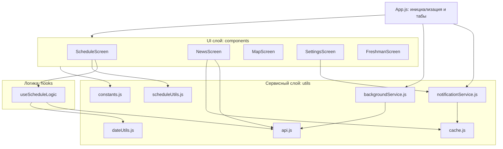
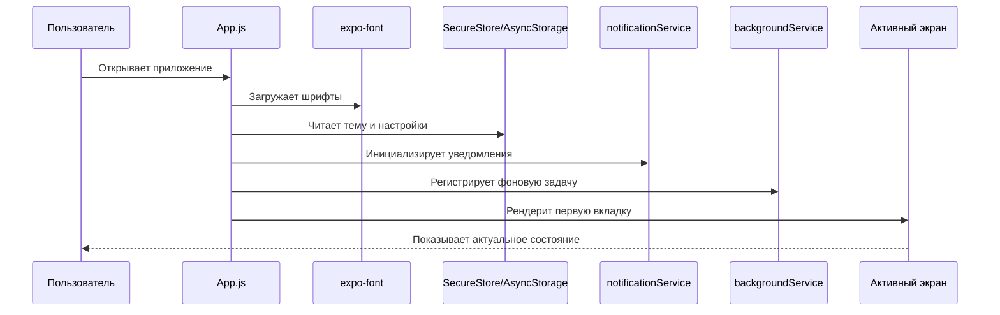
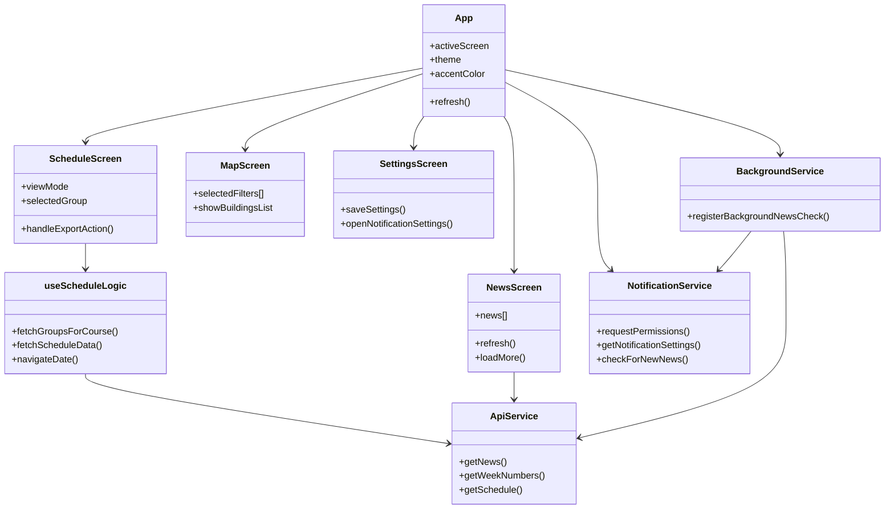

# Архитектура приложения

## Технологический стек

Приложение "Мой ИТИ ХГУ" построено на современном технологическом стеке, ориентированном на кроссплатформенную разработку с акцентом на нативный пользовательский интерфейс:

*   **React Native:** Версия 0.86 (с учётом обновления до Expo SDK 58).
*   **Expo:** Версия 58 (обновлено с 57).
*   **React:** Версия 19.
*   **`react-native-screens`:** Для нативной навигации и вкладок iOS.
*   **`expo-calendar` (SDK 57):** Для работы с календарём (разрешения, экспорт).
*   **`expo-media-library`:** Для экспорта изображений в галерею (только добавление).
*   **`expo-notifications` и `expo-background-fetch`:** Для уведомлений и выполнения фоновых задач.
*   **`expo-glass-effect`:** Для реализации эффектов Liquid Glass на iOS.
*   **`@react-native-menu/menu`:** Для нативных контекстных меню на iOS.
*   **`AsyncStorage` и `SecureStore`:** Для локального хранения данных.
*   **Sentry:** Для мониторинга ошибок и производительности.

## Точка входа и композиция приложения

*   **Точка входа:** Приложение начинается с `index.js`, который регистрирует `App.js` как корневой компонент.
*   **`App.js`** является центральным компонентом, отвечающим за:
    *   **Первичная загрузка:** Загрузка шрифтов и отображение сплэш-экрана.
    *   **Сплэш-экран:** Отображается в течение **3.5 секунд**. Имеет уникальный дизайн с прозрачными/стеклянными элементами, поддержкой темы/акцента/сезона/праздника/Matrix/Legend, центрированным вертикальным логотипом, метками версии/сборки и непрерывной анимацией конфетти-эмодзи, которая располагается между фоном и элементами логотипа/текста. Анимация конфетти имеет рандомизированные начальные точки в верхней части экрана, полностью падает за пределы экрана и имеет регулируемую скорость. В настройках внешнего вида есть переключатель для отключения анимации конфетти.
    *   **Управление темой:** Управление активной темой и акцентным цветом приложения.
    *   **Навигация:** Переключение между основными экранами через нативный таб-бар (iOS) или системную навигацию (Android).
    *   **Инициализация сервисов:** Инициализация уведомлений, фоновой логики и интеграции Sentry.

**Основной порядок вкладок** определяется константой `TAB_ORDER` в `App.js` и включает:

*   Расписание
*   Карта
*   Студгородок (Freshman)
*   Новости
*   Настройки

## Слои ответственности

### 1. UI-слой: `components/`

Компоненты UI отвечают за рендеринг интерфейса, обработку пользовательских взаимодействий, локальные анимации и управление визуальным состоянием. Они спроектированы с учётом нативных особенностей iOS и кроссплатформенности.

**Ключевые экраны и компоненты:**

*   **`components/OnboardingScreen.js`**: Реализует пятистраничный онбординг, который появляется только один раз при первом запуске приложения. Включает плавные анимированные переходы между страницами, нативные кнопки навигации iOS Liquid Glass, финальную пятую страницу с обильным конфетти и запрос разрешения на доступ к галерее на странице 3. Модальные окна функций/конфиденциальности онбординга реализованы как ограниченные нижние листы (`NativeSheet`), поддерживающие жесты вертикального расширения/сворачивания и закрытие по фону, а не полноэкранные модальные окна.
*   **`components/ScheduleScreen.js`**: Экран расписания занятий. Поддерживает экспорт полного расписания в формате PNG в галерею (с разрешением только на добавление), отображение заметок, дедлайнов домашних заданий, избранных занятий, посещаемости и поиск свободных аудиторий с выбором недели/дня/пары. Включает видимые подсказки состояния загрузки/обновления расписания.
*   **`components/NewsScreen.js`**: Экран ленты новостей. Поддерживает пагинацию, обновление (refresh), поиск и fallback на кэшированные данные при отсутствии сети. Включает видимые подсказки состояния загрузки/обновления новостей.
*   **`components/MapScreen.js`**: Интерактивная карта корпусов университета. Включает кастомные нижние листы фильтров карты и маршрутов (`NativeSheet`), которые начинаются с 50% высоты, расширяются до 80%, поддерживают множественный выбор, затемнение фона, жесты перетаскивания и работающие кнопки закрытия. Нативные оповещения/меню-заглушки удалены. Интерактивная карта Android намеренно отключена.
*   **`components/SettingsScreen.js`**: Экран настроек приложения. Позволяет управлять параметрами темы, уведомлений, учебного профиля, просматривать историю изменений и системные функции.
*   **`components/AcademicCalendarScreen.js`**: Экран учебных событий. Позволяет добавлять события из панели действий фильтров, редактировать и экспортировать их в календарь устройства и в формат ICS.
*   **`components/AcademicEventModal.js`**: М��дальное окно для создания и редактирования учебного события, реализованное как нативный iOS `pageSheet` (нижний лист), согласованное по реализации и размерам с окнами `FreeAuditoriesScreen` и `AttendanceStatsModal`.
*   **`components/ScheduleChangesHistoryScreen.js`**: Отдельный экран для просмотра истории изменений расписания с diff-представлением.
*   **`components/CommunityScreen.js`**: Раздел для локальных черновиков материалов и анонимных отзывов. Публикация между пользователями требует бэкенда и модерации.
*   **`components/DeveloperMenuScreen.js`**: Меню разработчика, включающее элементы управления предпросмотром сплэш-экрана и другие отладочные функции.
*   **`components/NativeSheet.js`**: Общий, расширяемый компонент нижнего листа, используемый для модальных окон онбординга и листов фильтров карты. Поддерживает независимую непрозрачность фона и перевод панели через `Animated`/`PanResponder`, а также жесты вертикального расширения/сворачивания.
*   **`components/IOSEdgeSwipeBack.js`**: Компонент, реализующий жест возврата по левому краю экрана на iOS, включённый только для активных внутренних подразделов Map/Freshman/Settings и маршрутируемый через существующие дочерние ссылки `goBack()`.
*   **`components/SplashScreen.js`**: Уникальный сплэш-экран приложения, перерисованный с прозрачными/стеклянными элементами, поддержкой темы/акцента/сезона/праздника/Matrix/Legend, центрированным вертикальным логотипом, версией внизу слева, номером сборки внизу справа и элементами управления предпросмотром для разработчиков. Длится 3.5 секунды, включает непрерывную анимацию конфетти-эмодзи, адаптирующуюся к сезону/празднику, расположенную между фоном и элементами логотипа/текста, с рандомизированными начальными точками в верхней части экрана, полностью падающую за пределы экрана и имеющую регулируемую скорость. В настройках внешнего вида есть переключатель для отключения анимации конфетти.
*   **`components/RefreshStatusHint.js`**: Общий индикатор состояния загрузки/обновления, используемый на экранах расписания и новостей.
*   **`components/AppearanceSettingsSheet.js`**: Настройки внешнего вида, включая переключатели для сплэша легенды и анимации конфетти.
*   **`components/SeasonalSplashEffects.js`**: Логика анимации конфетти-эмодзи для сплэш-экрана, адаптирующаяся к сезону/празднику.

### 2. Логический слой: `hooks/`

- `useScheduleLogic.js` инкапсулирует состояние расписания:
  - курс, группы, текущая неделя или дата;
  - онлайн или оффлайн статус;
  - загрузка расписания и времени пар;
  - переходы по датам и обновление данных.

Принцип: экран остается тонким, бизнес-логика выносится в хук или утилиты.

### 3. Сервисный слой: `utils/`

Сервисный слой содержит утилиты и модули, которые инкапсулируют логику взаимодействия с внешними API, локальным хранилищем и системными функциями.

*   **`utils/api.js`**: Модуль для выполнения сетевых вызовов к бэкенду и адаптации его ответов для использования в приложении.
*   **`utils/cache.js`**: Реализует TTL-кэш с валидацией и механизмами очистки повреждённых или устаревших записей.
*   **`utils/notificationService.js`**: Управляет разрешениями, настройками и логикой отправки и получения уведомлений.
*   **`utils/backgroundService.js`**: Отвечает за регистрацию и выполнение фоновых задач, таких как периодическая проверка наличия новых новостей.
*   **`utils/favoritesStorage.js`**: Модуль для локального хранения и управления избранными сущностями расписания.
*   **`utils/attendanceStorage.js`**: Хранит и агрегирует данные о посещаемости, используя ключ, основанный на дате и типе пары.
*   **`utils/academicEventsStorage.js`**: Локальное хранилище для учебных событий, созданных пользователем.
*   **`utils/studyProfileStorage.js`**: Локальное хранилище для учебного профиля пользователя.
*   **`utils/dateUtils.js`**, **`utils/scheduleUtils.js`**: Вспомогательные утилиты для выполнения вычислений, связанных с датами, и обработки данных расписания.
*   **`utils/communityStorage.js`**: Локальное хранилище для черновиков учебных материалов и отзывов о преподавателях, используемых в разделе «Сообщество ИТИ».
*   **`utils/calendarAccess.js`**: Управляет запросами разрешений для доступа к календарю устройства, используя Expo Calendar SDK 57.
*   **`utils/calendarExport.js`**: Реализует логику экспорта учебных событий в календарь устройства, используя объектный API Expo Calendar SDK 57 с полным доступом (`writeOnly: false`).
*   **`utils/galleryExport.js`**: Управляет разрешениями и логикой экспорта изображений (например, скриншотов расписания) в галерею устройства, используя `expo-media-library` с разрешением только на добавление (`Asset.create()`), без чтения фотобиблиотеки пользователя.
*   **`utils/constants.js`**: Централизованное хранилище констант приложения, включая версии, длительность сплэш-экрана, информацию о праздниках и палитру тем `LIQUID_GLASS` с параметрами `cardBlurTint` и `cardBlurIntensity` для нативного Liquid Glass на iOS.
*   **`utils/liquidGlass.js`**: Утилитарные функции и стили, спе��ифичные для реализации Liquid Glass дизайна на iOS.

## Liquid Glass (iOS)

На iOS 26+ поддерживаемые поверхности приложения используют нативный системный эффект Liquid Glass через `expo-glass-effect` (`GlassView`), обеспечивая современный и отполированный внешний вид. Этот эффект адаптируется к системной теме и акценту.

*   **Header (Верхняя панель)**: В `App.js` используется системный `GlassView`, когда флаг `feature_liquid_glass_enabled` включён и функции `isLiquidGlassAvailable()` и `isGlassEffectAPIAvailable()` возвращают `true`. Верхняя панель (`HeaderToolbar`) также использует системный стеклянный материал, где основные действия доступны непосредственно, а дополнительные раскрываются через привязанное к кнопке `UIMenu` (`@react-native-menu/menu`). Поиск использует общий `SearchField` (React Native TextInput), а контекстные действия — системные action sheets. Это не `UINavigationBar`, `UISearchController` или preview-контекстное меню.
*   **Tab Bar (Нижняя панель вкладок)**: Реализован как настоящий `UITabBarController` через `Tabs.Host` / `Tabs.Screen` из `react-native-screens` в `components/NativeTabBar.js`. Пилюля активной вкладки, материал и анимации рисуются UIKit (Liquid Glass на iOS 26+), что исключает необходимость в нарисованном вручную iOS-селекторе. Акцент передаётся в `tabBarTintColor` и выбранное состояние иконки и подписи. Нативный таббар не зависит от переключателя стекла; на старых версиях iOS используется системный вид, соответствующий версии. Для корректной работы требуется новая нативная сборка с `react-native-screens`.
*   **Онбординг и листы карты**: Модальные окна функций/конфиденциальности онбординга и листы фильтров карты/зданий реализованы как кастомные ограниченные нижние листы (`NativeSheet`), а не полноэкранные модальные окна или системные оповещения/меню. Эти листы начинаются с 50% высоты, расширяются до 80%, поддерживают множественный выбор, затемнение фона, жесты перетаскивания и кнопки закрытия.
*   **Жест возврата по краю**: iOS внутренние подразделы (Map/Freshman/Settings) поддерживают свайп влево для возврата через `components/IOSEdgeSwipeBack.js`, маршрутируемый через существующие дочерние ссылки `goBack()`.
*   **Группы настроек**: Используют непрозрачные тематические поверхности `SettingsGroup`, чтобы длинные списки сохраняли читаемость. `GlassCard` остаётся отдельным компонентом для явно выбранных стеклянных поверхностей. У `GlassView` нет встроенного padding; отступы задаются один раз содержимому, расстояния между группами — снаружи.
*   **SF Symbols**: Нативный таббар использует SF Symbols, системную компоновку и акцент для выбранного состояния.
*   **Схема заголовка и нативного таббара** следует эффективной теме приложения. Карточки используют системную схему (`auto`), кроме специальных тёмных тем.
*   **Fallback для Glass API**: Для заголовка и карточек при недоступном Glass API используется `expo-blur` как fallback; Android сохраняет обычные поверхности.
*   **Ограничения `GlassView`**: `GlassView` нельзя помещать в родитель с `opacity: 0`: это отключает эффект. Для такой анимации нужно использовать нативный `glassEffectStyle` transition.
*   **Визуальное соответствие**: Это даёт нативный системный материал Liquid Glass, но не автоматически превращает каждый элемент приложения в системный UI. Полное визуальное соответствие iOS требует ручной проверки на устройстве и дальнейшего аудита кастомных карточек, кнопок и анимаций.
*   **Проверка на устройстве**: Подтверждённая доступность API не равна подтверждённому визуальному результату: устройство iOS 27 должно быть проверено после нативной сборки приложения. Необходимо проверить header, tab bar, карточки и все темы; сравнить с системными панелями, проверить Reduce Transparency.
*   **Установка `expo-glass-effect`**: Требует пересборки native binary / development build, если используемая сборка не содержит этот модуль. Переключатель в Меню разработчика переключает системный эффект и BlurView без reload; он позволяет сравнить варианты на устройстве.

Ссылки: [Expo GlassEffect SDK 58](https://docs.expo.dev/versions/v58.0.0/sdk/glass-effect/), [Apple UIVisualEffectView](https://developer.apple.com/documentation/uikit/uivisualeffectview).

## Потоки данных

### Поток расписания

1. Пользователь выбирает режим и фильтры на экране расписания.
2. `ScheduleScreen.js` использует `useScheduleLogic.js`.
3. Хук запрашивает данные через `utils/api.js`.
4. При сетевых проблемах используется fallback на кэш или локальные данные.
5. Экран показывает статус загрузки, ошибки и состояние кэша.

### Поток новостей

1. `NewsScreen.js` запрашивает новости через API.
2. Новости очищаются, нормализуются и дедуплицируются.
3. При недоступной сети применяется кэш, статус передается в хедер.
4. Фоновая задача может проверить наличие новых новостей и вызвать уведомление.

### Поток настроек

1. Пользователь меняет настройки темы, уведомлений и режима отображения.
2. Значения сохраняются в локальное хранилище.
3. При повторном запуске настройки загружаются и применяются д�� основных сценариев.

### Поток календаря

1.  Пользователь на экране `AcademicCalendarScreen.js` добавляет или редактирует учебное событие.
2.  Приложение запрашивает разрешение на доступ к календарю устройства через `utils/calendarAccess.js`.
3.  После получения разрешения, `utils/calendarExport.js` использует объектный API Expo Calendar SDK 57 для экспорта события в существующий календарь устройства.
4.  Пользователь может также экспортировать событие в формат ICS.

### Поток галереи

1.  Пользователь на экране `ScheduleScreen.js` инициирует экспорт расписания в виде изображения.
2.  Приложение запрашивает разрешение на доступ к галерее (только на добавление) через `utils/galleryExport.js`.
3.  После получения разрешения, `utils/galleryExport.js` использует `expo-media-library` и `Asset.create()` для сохранения изображения расписания в галерею устройства. Чтение фотобиблиотеки пользователя не производится.

## Архитектурные ограничения

- Не переносить тяжелую доменную логику в JSX-компоненты.
- Не изменять формат локального хранилища без совместимого перехода.
- Не вносить широкие изменения сразу в UI, hooks и utils без необходимости.
- Любой новый асинхронный поток должен иметь явный путь ошибки.

## Что проверять после архитектурных изменений

- Запуск приложения: `npm run start`.
- Отсутствие ошибок импорта в затронутых файлах.
- Базовые сценарии: расписание, новости, карта, настройки.
- Поведение при отсутствии сети и при восстановлении соединения.

## Визуальная схема слоев

## Схема запуска приложения

## Карта ключевых модулей

